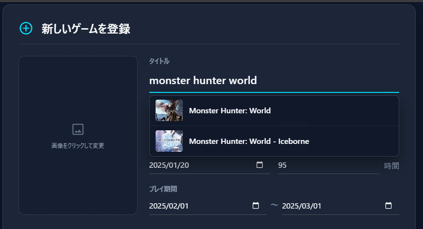
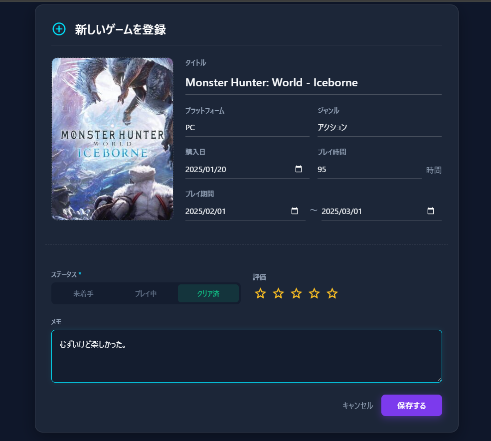
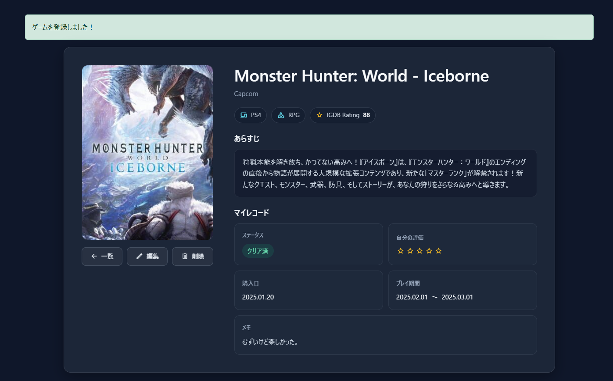
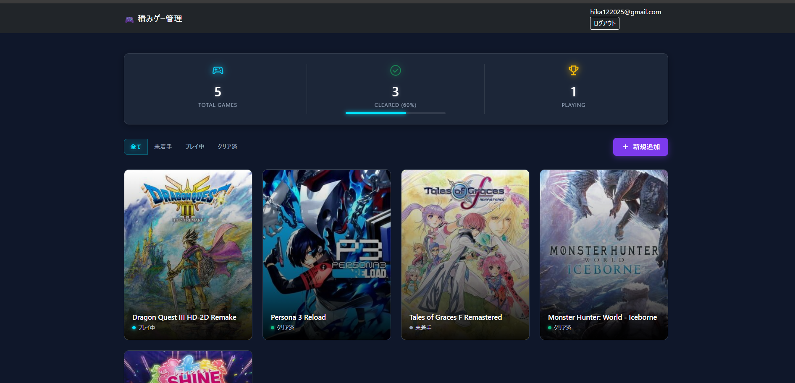

# ツミクエスト (Tsumi-Quest)

[](https://game-backlog.onrender.com)

積まれたゲームはあなたが挑むべきクエストだ！
「ツミクエスト」は、増え続ける積みゲーをRPG感覚で楽しく管理・消化するWebアプリです。

## アプリの利用フロー

### 1. タイトル検索とサジェスト機能

新しいゲームを登録する際、タイトルを一部入力するだけで、外部API（IGDB）からリアルタイムに該当ゲームの候補とパッケージ画像をサジェストします。

### 2. データ自動入力と直感的な記録

サジェストから選択すると、ゲームパッケージ画像や基本データ（プラットフォーム、ジャンルなど）が自動でセットされます。ユーザーは購入時期やプレイ期間、プレイ時間や自分だけの評価やメモを入力します。

### 3. リッチな詳細画面とホーム画面の構築
| 登録後の詳細画面 | ホーム画面 |
| :---: | :---: |
|  |  |

裏側でDeepL APIを呼び出し、英語のあらすじデータを自動で日本語に翻訳して表示します。登録を終えると、美しいパッケージが並ぶ「自分だけのゲーム棚」がホーム画面に構築されます。

## 制作のきっかけ
「買ったのに遊んでいない…」そんな積みゲーに対する罪悪感を、RPGのクエストをクリアするような達成感に変えたいという思いから開発しました。
単なるタスク管理ツールではなく、ゲームパッケージが並ぶ自分だけのゲーム棚を構築することで、ゲームをプレイするモチベーションを向上させる体験を目指しています。

## 主な機能
* **ユーザー認証:** Clerkのログイン・新規登録画面とセッション管理（アプリ内ユーザーとの認証連携は移行中）
* **ゲーム検索・自動入力:** 外部API(IGDB)と連携し、タイトル検索だけでゲームパッケージ画像や詳細データを自動取得
* **ステータス管理:** 「未プレイ」「プレイ中」「クリア済」などの進行度やプレイ時間を記録
* **画像アップロード:** Active Storageによるオリジナル画像のアップロード。パッケージ画像のないゲームに対して有効。

## 技術スタック
* **バックエンド:** Ruby 3.4 / Ruby on Rails 8.0
* **データベース:** PostgreSQL
* **フロントエンド:** Turbo / Stimulus (Hotwire), CSS
* **デプロイ:** Render
* **外部API:**
  * IGDB API (ゲームメタデータ・画像取得)
  * Resend API (メール配信)
  * DeepL API（ゲームのあらすじ翻訳）
  * Clerk (認証基盤への移行中)
* **AI:**
  * Gemini Pro（企画・要件定義・調べもの）
  * Github Copilot（コーディング）

## 技術的なこだわり・アピールポイント

### 1. モダンなRails 8アーキテクチャの積極採用
非同期処理（Active Job）やキャッシュ機構において、従来のRedisを用いた構成から脱却し、Rails 8の最新標準である `Solid Queue` と `Solid Cache` を採用しました。これにより、RDBMSのみで完結するシンプルでモダンなインフラ構成を実現しています。

### 2. 外部API活用
* **ゲーム検索・サジェスト表示:** `IGDB`を使ってゲーム検索、詳細情報取得を実現しました。
* **あらすじ翻訳:** `DeepL`を使って`IGDB`から取得したゲームのあらすじを日本語へ自動翻訳するようにしました。
* **アカウント有効化メール:**  `Resend` の公式HTTP APIで、セキュアで高速なメール配信を実現しました。コストの制約上、SMTPの主流ポート番号が使えないため、APIでメール配信を実装しました。

### 3. 外部API連携をカプセル化したファットコントローラ防止
Twitchが提供するIGDB APIを活用する際、OAuth2.0によるトークン取得・キャッシュ・API呼び出しのロジックを `IgdbApiService` クラスとしてカプセル化しました。コントローラをクリーンに保ちつつ、ユーザーが手動で画像を探す手間を省くUXを提供しています。

## 開発の進め方
* **大きいタスクを小さいタスクへ分割:** ある機能を実装したり、バクを修正する際にGeminiにタスクを最小単位に分割させるように心がけていました。そうすることでcopilotの１回あたりの実装量が減り、私のコードレビューの負担が減るからです。その後は小さいタスクを結合してPull Requestで元のタスクをmainブランチにマージするようにしています。技術・理解負債がたまらないように丁寧に開発を進めています。

## ローカル環境構築
```bash
# リポジトリのクローン
$ git clone [https://github.com/あなたのユーザー名/game_backlog.git](https://github.com/あなたのユーザー名/game_backlog.git)
$ cd game_backlog

# パッケージのインストール
$ bundle install

# データベースのセットアップ
$ rails db:create db:migrate db:seed

# 環境変数の設定 (IGDB API, Resend API, DeepL APIのキーを設定)
# .env ファイルを作成し、必要なキーを記述してください

# サーバーの起動
$ rails s 