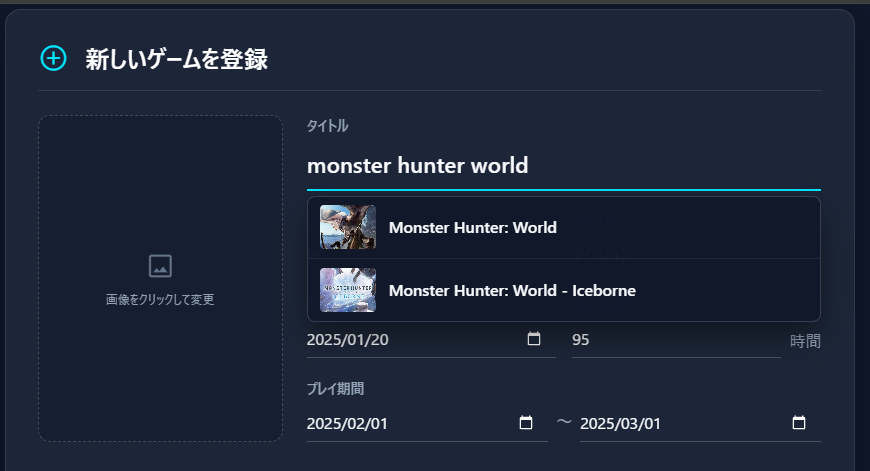
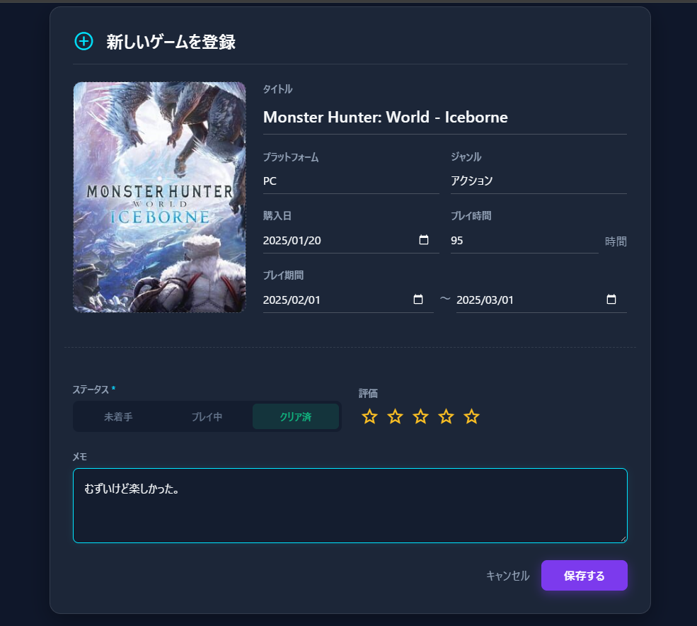
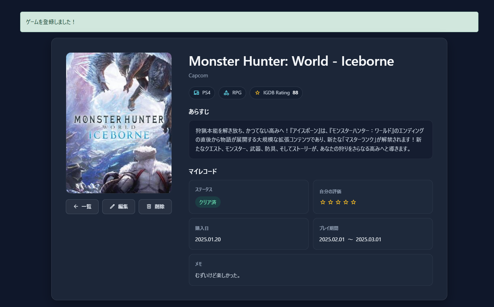
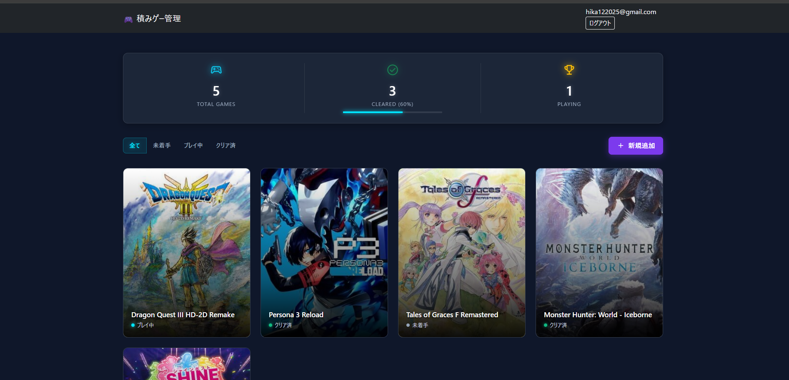
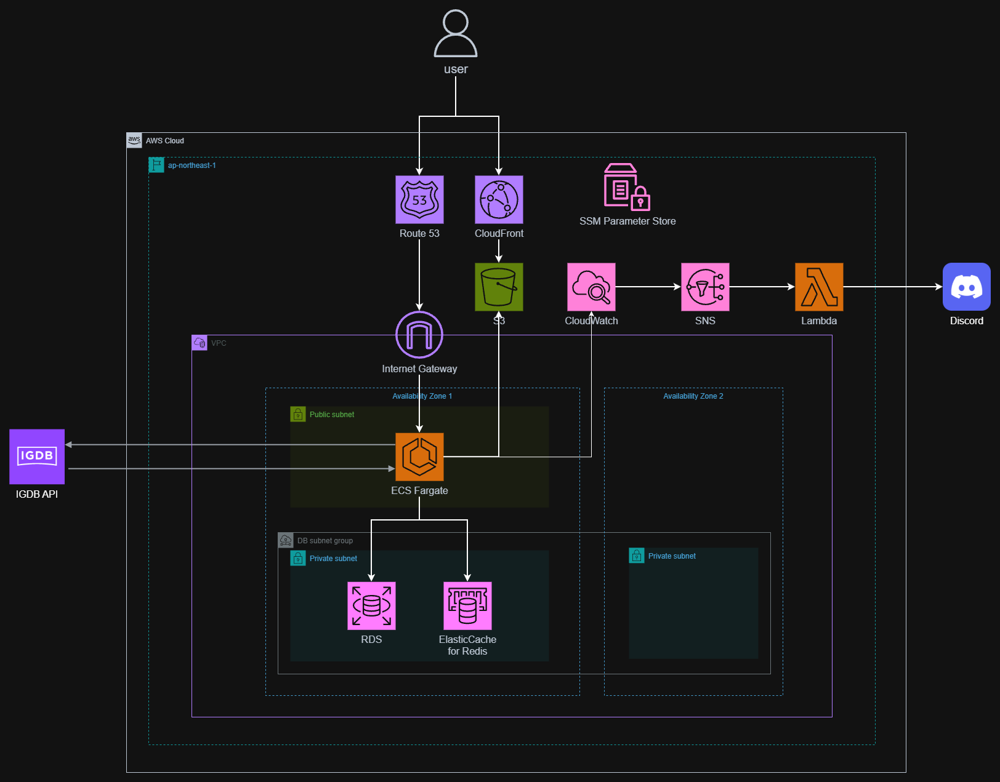

# ツミクエスト (Tsumi-Quest)

**積まれたゲームは、あなたが挑むべきクエストだ！**

「ツミクエスト」は、増え続ける積みゲーをRPG感覚で楽しく消化することを目指したWebアプリケーションです。ゲームのプレイ時間やクリア状況に応じて経験値を獲得したり、条件を達成してトロフィーを収集したりすることで、積みゲーを消化する過程そのものを楽しめる体験を提供します。

> ※インフラコスト最適化のため、非稼働時は Terraform の `-target` 指定により ECS・RDS・ElastiCache を停止しています（IaCは `terraform/` ディレクトリで公開しています）。

## ハッカソン出場

「技育展2026 オンライン予選大会」に出展しました。

- **発表資料：** [Canva スライド資料](https://canva.link/fg6ae2idpqml1ql)

## アプリの利用イメージ

### 1. ゲーム検索

ゲームタイトルを入力すると、IGDB APIと連携して該当するゲームの候補やパッケージ画像を取得します。タイトルの一部を入力するだけで候補を確認できるため、ゲーム情報を手動で入力する手間を減らしています。

---

### 2. ゲーム登録

検索候補からゲームを選択すると、パッケージ画像やプラットフォーム、ジャンルなどの情報が自動で入力されます。購入時期やプレイ期間、プレイ時間などを登録できます。

---

### 3. ゲーム詳細・ホーム画面

| ゲーム詳細画面 | ホーム画面 |
| :---: | :---: |
|  |  |

登録したゲームの詳細情報や進行状況を確認できます。また、ゲームパッケージが並ぶホーム画面によって、自分だけのゲーム棚を作ることができます。

## 制作背景

ゲームを購入したものの、なかなか遊ぶ時間が取れず、積みゲーが増えてしまうことがあります。私自身もそのような経験があり、積みゲーを単なる管理対象として扱うのではなく、RPGのクエストをクリアしていくような楽しさに変えられないかと考え、開発を始めました。

そこで、次の2つを重視して設計しました。

- **プレイするきっかけを作る：** ゲームのプレイ時間に応じて経験値を獲得できるようにし、ゲームを遊ぶこと自体がモチベーションにつながる仕組みを取り入れました。
- **クリアする達成感を高める：** ゲームをクリアすると固定の経験値報酬を獲得できるようにし、最後まで遊び切ることにも報酬を設けました。

単にゲームの進行状況を記録するだけでなく、ゲームを遊ぶことやクリアすることに楽しさを加えることを目指しています。

## 主な機能

### ゲーム管理
- IGDB APIと連携したゲームタイトル検索・サジェスト
- ゲーム情報・パッケージ画像の自動取得
- ゲームの購入時期、プレイ期間、プレイ時間、評価、メモの記録
- 「未プレイ」「プレイ中」「クリア済」などのステータス管理
- Active Storageによるオリジナル画像のアップロード

### RPG要素
- プレイ時間に応じた経験値の獲得
- ゲームクリア時の固定経験値報酬
- 経験値に応じたレベルアップ
- トロフィーの獲得
- ゲームの開始・クリア履歴を記録するアクティブログ

### その他
- Clerkによるユーザー認証
- DeepL APIによるゲームあらすじの日本語翻訳

## 開発で工夫したこと

### 1. ゲーム検索機能のパフォーマンス改善

ゲーム検索機能の実装当初、検索候補が表示されるまでに**約8秒**かかる問題がありました。原因を調査したところ、検索候補の取得時に、ゲームのあらすじを毎回 **DeepL API** で翻訳していたことが分かりました。

そこで、翻訳処理を検索時ではなく、ユーザーがゲームの保存を確定したタイミングで実行するように変更しました。これにより、検索時に不要な翻訳処理を行わずに済むようになり、表示時間を**約2秒**まで短縮しました。

さらに、検索速度を改善するため、**Amazon ElastiCache for Redis** によるキャッシュを導入しました。IGDB APIから取得したゲームの基本情報・詳細情報をRedisにキャッシュし、再検索時にはキャッシュから情報を取得する仕組みに変更しました。その結果、キャッシュ利用時のサジェスト表示時間を**約20ms**まで短縮し、同じゲームに対する不要な外部API通信も抑制しました。

> **改善結果**
>
> | 状態 | サジェスト表示時間 |
> | :--- | ---: |
> | 改善前 | 約8秒 |
> | 翻訳処理のタイミング変更後 | 約2秒 |
> | Redis導入後（キャッシュ利用時） | 約20ms |

---

### 2. 過去のゲーム記録にも価値を持たせるトロフィー機能

経験値機能は、現在またはこれからプレイするゲームのプレイ時間やクリアによって獲得する仕組みです。しかし、アプリの利用開始前にクリアしたゲームを登録しても、経験値は獲得できません。

そこで、過去にクリアしたゲームの登録にもメリットを持たせたいと考え、**トロフィー機能**を実装しました。累計クリア本数などの条件を達成するとトロフィーを獲得できるようにすることで、過去のゲーム実績も評価対象にしています。

これにより、これからプレイするゲームだけでなく、これまで遊んできたゲームも登録してコレクションしていく楽しさを提供しています。

---

### 3. CloudFront + ACM によるHTTPS化とデプロイ時のIP自動紐づけ

独自ドメイン（`tsumiquest.com`）で安全に通信できるよう、**Amazon CloudFront** と **AWS Certificate Manager（ACM）** を組み合わせてHTTPS化を行いました。

また、ECS Fargate ではタスクが再起動・再デプロイされるたびにパブリックIPアドレスが動的に変化します。そこで、**GitHub Actions** のデプロイワークフロー内に、起動したECSタスクの最新パブリックIPを AWS CLI で自動取得し、Route 53 のAレコード（`origin.tsumiquest.com`）を自動更新（`UPSERT`）する処理を組み込みました。これにより、`tsumiquest.com` と最新のECSコンテナが常に自動で紐づく仕組みを実現しています。

---

### 4. サーバーレスなシステム監視とDiscord通知基盤の構築

アプリケーションのエラーやリソースの高負荷を即座に検知できるよう、**CloudWatch・Amazon SNS・AWS Lambda** を連携させた監視・通知基盤を Terraform で構築しました。

- **アプリエラー監視：** CloudWatch Logs のメトリクスフィルターで Rails の500エラーや例外ログを検知
- **リソース監視：** CloudWatch Alarms で ECS の CPU・メモリ使用率の異常を検知
- **通知処理（Go製Lambda）：** Go で通知関数を実装し、異常検知時（`ALARM`）と自動復旧時（`OK`）に Discord へ自動通知

## 技術スタック

| 分類 | 技術 |
| :--- | :--- |
| バックエンド | Ruby 3.4 / Ruby on Rails 8.0 |
| フロントエンド | Turbo / Stimulus (Hotwire), CSS |
| データベース | PostgreSQL (Amazon RDS) |
| キャッシュ | Amazon ElastiCache for Redis |
| インフラ | AWS (VPC, ECS Fargate, S3, CloudFront, Route 53, ACM, SSM) |
| IaC | Terraform |
| 監視・通知 | Amazon CloudWatch / Amazon SNS / AWS Lambda (Go) / Discord Webhook |
| CI/CD | GitHub Actions |
| 外部API | IGDB API / DeepL API |
| 認証 | Clerk |
| AI | Gemini Pro / GitHub Copilot |

## AWSアーキテクチャ

### 技術選定理由

| 技術 / サービス | 選定理由 |
| :--- | :--- |
| **Terraform (IaC)** | AWSリソースの構築をコード化し、再現性を担保するため。 |
| **GitHub Actions (CI/CD)** | `main` ブランチへのマージをトリガーに、Dockerイメージのビルド・ECRへのプッシュ・ECSへのデプロイを自動化するため。デプロイ完了後には AWS CLI で新しいECSタスクのパブリックIPを動的取得し、Route 53 のAレコードを自動更新（`UPSERT`）することで、`tsumiquest.com` とECSの紐づけを自動化しています。 |
| **Amazon CloudFront / ACM** | 独自ドメイン（`tsumiquest.com`）でのSSL/TLS終端によるHTTPS化と、ゲームパッケージ画像のCDN配信を行うため。静的アセットの高速配信とセキュアな通信を両立しています。 |
| **Amazon ECS (Fargate)** | EC2のOS管理やパッチ適用などのサーバー運用負荷を省き、コンテナベースでアプリケーションを安定稼働させるため。 |
| **Amazon RDS (PostgreSQL)** | ユーザー情報、ゲーム記録、トロフィーなどの永続データを安全に管理するため。インターネットから隔離されたプライベートサブネットに配置しています。 |
| **Amazon ElastiCache (Redis)** | 外部API（IGDB API）のレート制限回避と検索サジェストの高速化のため。検索クエリの正規化（前後空白削除・小文字統一）とあわせて検索結果をキャッシュし、キャッシュ利用時のサジェスト表示時間を約20msまで短縮しました。 |
| **VPC / Security Group** | データストア層（RDS / ElastiCache）をインターネットから隔離されたプライベートサブネットへ配置し、Security Group によってECSからの特定ポート通信のみを許可する堅牢なネットワークを構成するため。 |
| **CloudWatch / SNS / Lambda (Go)** | アプリケーションの500エラーログやECSのCPU・メモリ高負荷を自動検知し、Discordへリアルタイム通知するため。通知関数はコールドスタートが速くメモリ消費の少ない Go で実装しています。 |
| **SSM Parameter Store** | DB認証情報や外部APIキーなどの機密情報をソースコードやリポジトリに一切残さず、`SecureString` として暗号化・一元管理するため。 |

## AIを活用した開発プロセス

個人開発において、Gemini ProとGitHub Copilotを活用しています。

- **Gemini Pro：** 企画・要件定義、技術調査、実装方針の検討、タスク分割などに利用。
- **GitHub Copilot：** コードの実装や修正に利用。

開発では、大きな機能を一度に実装させるのではなく、Geminiを活用してタスクを小さな単位に分割するようにしています。その後、GitHub Copilotで個別のタスクを実装し、コードを確認しながら段階的に進めています。小さな変更を積み重ね、Pull Requestを通じてmainブランチに統合することで、一度に確認するコード量を抑え、実装内容の理解が不十分なまま開発が進むことを防ぐようにしています。

## 今後の展望

- ユーザー同士でゲームのプレイ記録や進捗を共有する機能
- ゲームのプレイ予定を管理できるカレンダー機能